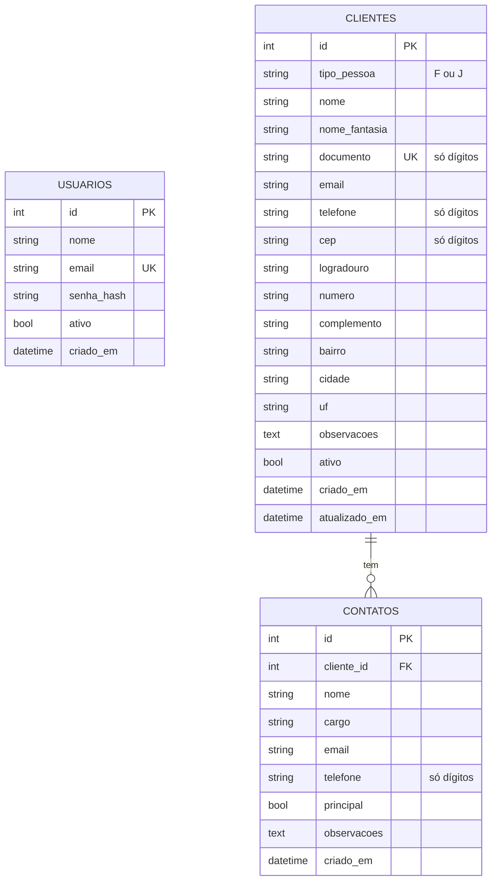

# Banco de dados

SQLite no desenvolvimento, acessado pelo Flask-SQLAlchemy. As tabelas são criadas por
`flask init-db` (`db.create_all()`); ainda não há migrations.

## Diagrama

`USUARIOS` não se relaciona com as outras tabelas: hoje não se registra quem cadastrou ou alterou
um cliente.

## Regras de integridade

| Regra | Onde é garantida |
|---|---|
| E-mail de usuário único | Índice único em `usuarios.email` |
| Documento de cliente único | Índice único em `clientes.documento` + validação no formulário e na importação |
| Documento válido (módulo 11) | `app/utils/validators.py`, chamado pelo formulário e pela importação |
| No máximo um contato principal por cliente | Controller de contatos e importação (não há restrição no banco) |
| Contatos removidos junto com o cliente | `cascade="all, delete-orphan"` e `ondelete="CASCADE"` |
| Cliente não é apagado pela interface | Só existe a rota de inativar/reativar |

## Índices

`usuarios.email`, `clientes.nome`, `clientes.documento` e `contatos.cliente_id`.

## Datas

`criado_em` e `atualizado_em` são gravados em UTC (`datetime.now(timezone.utc)`).

## Pontos em aberto

- Sem migrations: qualquer mudança de schema hoje exige recriar o banco de desenvolvimento.
- SQLite atende ao uso local; um uso multiusuário em produção pediria PostgreSQL.
