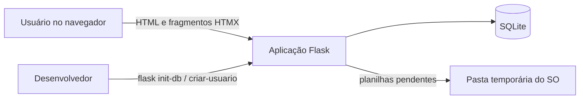
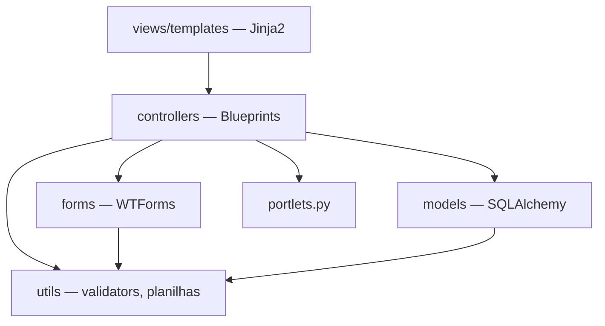

# Arquitetura — visão geral

Aplicação web monolítica em Flask, organizada em MVC, renderizada no servidor com Jinja2 e
interatividade parcial via HTMX.

## Stack

| Camada | Tecnologia |
|---|---|
| Linguagem | Python 3.10+ |
| Framework web | Flask 3 |
| ORM | Flask-SQLAlchemy |
| Banco | SQLite (desenvolvimento) |
| Autenticação | Flask-Login + hash de senha do Werkzeug |
| Formulários e CSRF | Flask-WTF / WTForms |
| Planilhas | openpyxl e `csv` da biblioteca padrão |
| Interface | Jinja2, Bootstrap 5, HTMX e JavaScript próprio |
| Testes | pytest |

## Contexto

## Camadas

| Camada | Pasta | Responsabilidade |
|---|---|---|
| Model | `app/models/` | Entidades, colunas, relacionamentos e propriedades de exibição |
| View | `app/views/templates/` | Páginas e fragmentos parciais (prefixo `_`) |
| Controller | `app/controllers/` | Rotas por módulo, orquestração e regras de aplicação |
| Forms | `app/forms/` | Validação de entrada e CSRF |
| Utils | `app/utils/` | Regras puras: CPF/CNPJ, formatação, leitura e escrita de planilhas |

Detalhes por camada:

- [Backend](backend/overview.md) — rotas, blueprints e fluxos
- [Banco de dados](database/schema.md) — tabelas e regras de integridade
- [Segurança](security/overview.md) — autenticação, CSRF e validação
- [Frontend](frontend/overview.md) — templates, HTMX, portlets e tema

## Fluxos principais

1. **Login** — `auth.login` valida credenciais, abre a sessão e redireciona ao painel.
2. **Cadastro de cliente** — formulário valida documento e duplicidade, o controller normaliza os
   campos para só dígitos e grava.
3. **Busca** — digitação dispara requisição HTMX; o controller devolve só o fragmento da tabela.
4. **Importação** — envio → validação linha a linha sem gravar → pré-visualização → confirmação
   grava cada cliente em sua própria transação.

## Decisões que moldam a arquitetura

Ver o [índice de decisões](../decisions/README.md), em especial 0001 (Flask MVC), 0003 (Jinja e
HTMX) e 0006 (registro de portlets).
